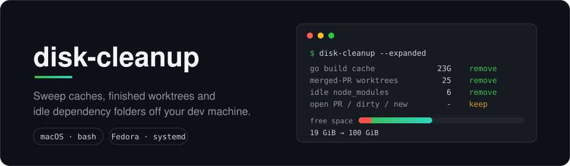
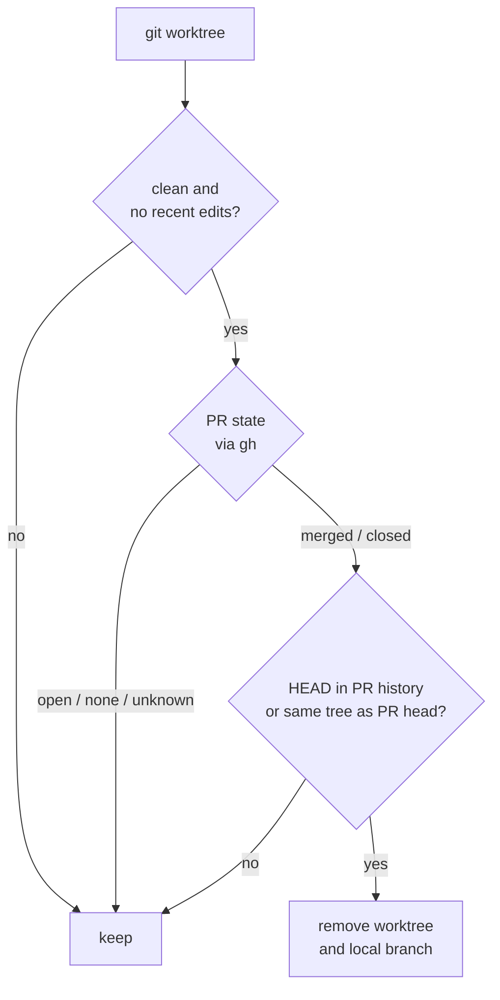

# disk-cleanup



Reports, and optionally removes, the disk space a developer machine quietly
accumulates: build and package caches, git worktrees whose pull request is
finished, and dependency folders nobody has touched. **Dry run by default.**

## What it cleans

| Tier | Flag | Targets |
|---|---|---|
| Caches | `--apply` | Go build/test cache, npm, pnpm, uv, Bun, pip, Homebrew, Cargo, Corepack, kubectl, gh, pre-commit, trivy, gopls, lima, Playwright, browser service-worker caches, unused container images and build cache |
| Expanded | `--apply --expanded` | worktrees with a merged or closed PR, idle `node_modules` / `.venv` / `venv` / `dist` (also in projects outside any repository), stale `__pycache__` and linter caches, Go module cache |
| Volumes | `--volumes` | unused container volumes (**data loss**) |

## How a worktree is judged

A worktree is removed only when every check passes. Anything else is listed as
kept, with the reason.



## Pick your platform

| Directory | Platform | Worktree rule |
|---|---|---|
| [`macos/`](macos) | macOS (bash 3.2), weekly via launchd | PR-aware, skips anything modified within the keep window |
| [`fedora/`](fedora) | Fedora / Linux, weekly via a systemd timer | same script and PR-aware rule |

## Quick start (macOS)

```sh
install -m 755 macos/disk-cleanup ~/.local/bin/disk-cleanup
disk-cleanup --expanded          # report only, nothing is deleted
disk-cleanup --apply --expanded  # clean, asks for typed confirmation
```

Read the dry-run output before scheduling the weekly job; both platform
READMEs show how.

## Layout

```text
assets/    banner
macos/     script, launchd plist, README
fedora/    script, systemd service and timer, README
tests/     fixture tests, run on Linux in CI
```

## Safety and speed

- One deletion guard: symlinks, relative paths and anything outside `$HOME` or
  the dev root are refused, and every removal is written to an audit log.
- OrbStack and Lima data are reported but never removed.
- Worktree PR lookups run in parallel batches.
- A fixture test suite (`tests/`) runs in CI against a throwaway `$HOME`.
- `fedora/disk-cleanup` is the same script as `macos/disk-cleanup`; CI fails if they differ.

## See also

[Mole](https://github.com/tw93/Mole) (GPL-3.0) covers what this tool does not:
system and app caches, leftovers of uninstalled apps, an uninstaller and a disk
analyzer. It removes build artifacts such as `node_modules` inside worktrees
but never the worktrees themselves, which is the gap this tool fills by
checking the PR state. The two work side by side.

## Contributions

This is a personal tool. Pull requests from non-collaborators are disabled;
fork it if you want to change it. Security reports: see [SECURITY.md](SECURITY.md).

Use at your own risk. Licensed under Apache-2.0.
