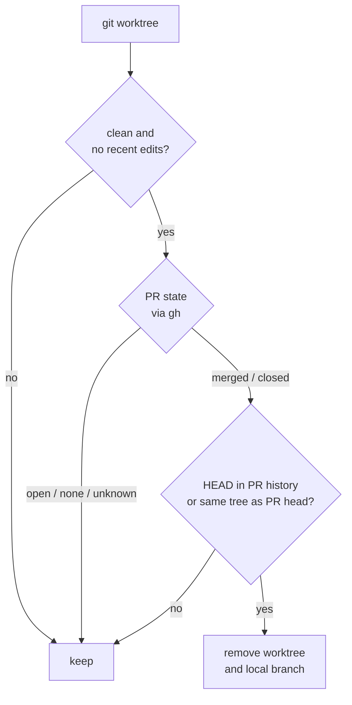

# disk-cleanup


Reports, and optionally removes, the disk space a developer machine quietly
accumulates: build and package caches, git worktrees whose pull request is
finished, and dependency folders nobody has touched. **Dry run by default.**

## What it cleans

| Tier | Flag | Targets |
|---|---|---|
| Caches | `--apply` | Go build/test cache, npm, uv, Bun, pip, Homebrew, trivy, gopls, lima, Playwright, unused container images and build cache |
| Expanded | `--apply --expanded` | worktrees with a merged or closed PR, idle git-ignored `node_modules` / `.venv` / `venv` / `dist`, Go module cache |
| Volumes | `--volumes` | unused container volumes (**data loss**) |

## How a worktree is judged

A worktree is removed only when every check passes. Anything else is listed as
kept, with the reason.



## Pick your platform

| Directory | Platform | Worktree rule |
|---|---|---|
| [`macos/`](macos) | macOS (bash 3.2), weekly via launchd | PR-aware, skips anything modified within the keep window |
| [`fedora/`](fedora) | Fedora / Linux, weekly via a systemd timer | lists clean worktrees whose last commit is older than 7 days |

## Quick start (macOS)

```sh
install -m 755 macos/disk-cleanup ~/.local/bin/disk-cleanup
disk-cleanup --expanded          # report only, nothing is deleted
disk-cleanup --apply --expanded  # clean, asks for typed confirmation
```

Read the dry-run output before scheduling the weekly job; both platform
READMEs show how.

## Layout

```text
assets/    banner
macos/     script, launchd plist, README
fedora/    script, systemd service and timer, README
```

## Contributions

This is a personal tool. Pull requests from non-collaborators are disabled;
fork it if you want to change it. Security reports: see [SECURITY.md](SECURITY.md).

Use at your own risk. Licensed under Apache-2.0.
